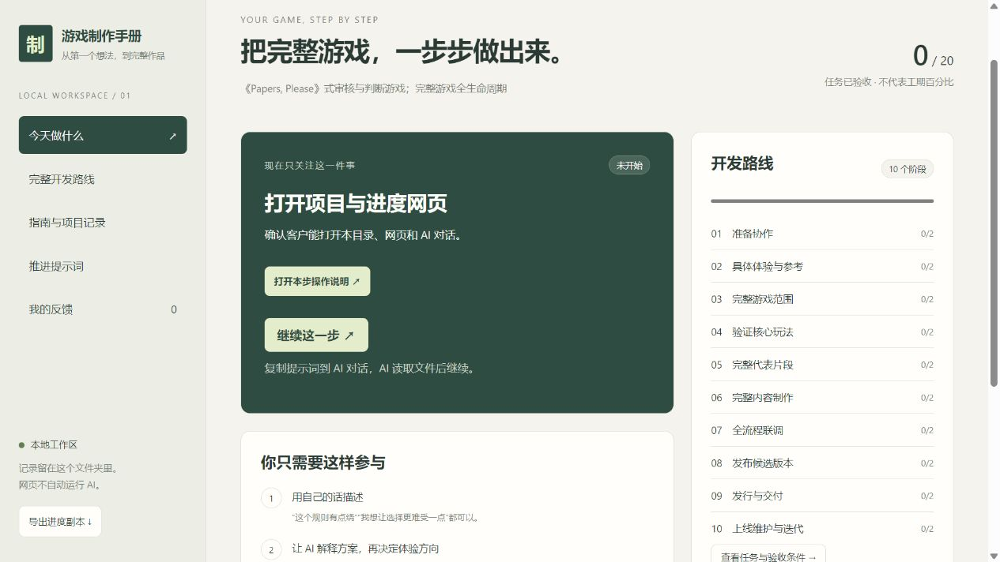

# V0.2 走查修复验收

日期：2026-11-10。范围：工作流交付包，不是客户 Unity 游戏。依据：[V0.1 完整走查报告](新手走查_2026-11-10/完整走查报告.md)。

## 本轮结果

F01–F06 的状态与网页缺陷已修复；F07 保留已有资料接收流程；F08–F12 补齐执行规范、客户指南、skills、操作卡/交付模板和提示词。客户游戏仍有 20 项基线任务全部未验收。实际 state 的 revision 为 1，仅通过受校验操作登记 T00 操作卡；没有写入测试反馈或伪造游戏进展。

| 编号 | 修复或补齐 | 验证证据 |
|---|---|---|
| F01 新增任务被阻止 | 允许新增批次；只重开阶段检查点及真实下游，T51 等无关工作保留 | 生命周期扩展与补丁回归测试 |
| F02 证据移动锁死全项目 | 结构与证据健康分离；可读、导出、反馈、重开；repair_reference 留原因并修引用 | 文件改名测试及 HTTP 读/导出/反馈测试 |
| F03 早期反馈全量回退 | 问题先待核实，按真实依赖重开；展示历史证据；交付版本保留快照 | 反馈不重开、环境变更不重开设计、版本快照测试 |
| F04 已知失败仍验收 | 所有失败逐条处理；复测明确关联，非阻塞处置需客户记录；最低门槛不能豁免 | 可选失败、处置、必需失败不可豁免测试 |
| F05 依赖方向与总验收 | 配置真实依赖；检查点自动依赖本阶段工作；T50 至少需要实际制作批次 | 全生命周期、反向依赖成环拒绝测试 |
| F06 草稿丢失 | 按项目保存文字/类别/任务；导航和刷新恢复，保存成功才清理 | 本轮实际浏览器操作，隔离副本反馈 |
| F07 客户已有资料 | 保留原件、先清点阅读复述、标来源与冲突，再提问 | 保留既有规范及资料接收情境检查；尚未收到真实客户文件 |
| F08 环境准备 | 解释器版本预检与回退；doctor 检查；首次读写、网页同步、反馈答复闭环及失败分支 | 本机预检实际执行；首次流程桌面检查；干净客户电脑未实测 |
| F09 当前一步 | instructions 操作卡门槛；首页/任务入口；默认当前指南；文档内链接可连续打开 | 实际浏览器打开操作卡、故障指南、默认文档分类 |
| F10 范围估算 | 完整体验选项、暂定计划、代表片段实测成本、批量确认 | 规范/范围模板/设计与引导 skills 情境检查 |
| F11 资源真实生产 | 实际工具/账号/预算路线；图像音频样本、回传、导入、游戏内验证和占位替换 | 规范与美术/程序 skills 情境检查；没有生成正式客户资源 |
| F12 交付维护 | 版本清单、独立运行/存档/恢复操作、不可覆盖快照、补丁任务和求助交接 | 状态生命周期含 1.0→1.0.1→扩展内容的隔离演练；实际构建发布未执行 |

## 实际验证

- 状态与 HTTP：30 项通过，完整输出见 [测试记录](V0.2状态与接口测试.txt)。包括无证据禁止验收、revision 冲突、锁/损坏保护、路径与跨域限制，以及本轮新增的状态修复场景。
- 六个 skills 通过官方 quick_validate；已检查新增引用和场景路由。五个技能增加必要执行衔接，竞品参考技能保持已有按需查证规则。
- app.js 与 browser.cjs 通过 Node 语法检查。browser.cjs 已补导航/刷新草稿回归和新版分类、20 条提示词适配；**本轮未通过该脚本执行自动浏览器测试**，浏览器验证使用 CUA 实际操作。
- CUA：在隔离副本填写文字、选择“遇到了问题”和“确认合作方式”；切换指南再返回，文字/类别/关联任务保持；刷新再进入反馈，三项仍保持；提交后列表出现且输入框清空。未提交草稿没有写入正式反馈。测试记录不属于客户项目。
- 正式入口：实际打开 T00 卡片，再点卡片内故障指南链接，成功连续阅读；首页截图见下方。正式项目反馈仍为 0。
- 本机 Python 3.12.14；本地读写、状态结构检查通过，见 [环境检查](V0.2环境检查.json)。未检测到 Game 根目录工程结构；不把它等同于全机无 Unity。
- Markdown 本地链接与 skill frontmatter 由 check_package.py 检查；最终结果在交接文档登记。

## 正确性与必要性复查

由同一 AI 分轮自审，未声称独立代理 Review。正确性复查沿“资料→操作卡→制作批次→阶段验收→交付快照→补丁”检查依赖、证据和文档一致性；回归测试与浏览器覆盖实际缺陷触发条件。必要性复查保留单一 state 权威，不新增平行项目管理系统、不接入模型服务、不引入额外 Python 依赖；技术协议留给 AI，客户入口只显示当前动作与指南。

文本存在仍不能证明内容真实，AI 必须读取证据、确认失败处置和客户授权；本地工具只校验可判定结构与门槛。历史复现脚本/报告用于说明 V0.1 问题，不能把它们当 V0.2 预期行为。

## 尚未验证的真实条件

尚未由真实零经验客户使用全流程；尚未取得客户世界观原件；未在干净客户机器测试安装；未建立实际 Unity 工程、生成最终素材、测试游戏设备、发布或执行真实补丁。所有相应验证已安排到实际阶段，不能凭本包检查宣布客户游戏完成。没有 Git 提交、推送或对外发布。
